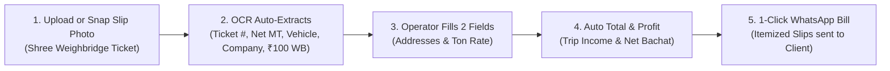

# 🚛 FleetTrack Pro - Mining Truck Fleet, Diesel & Weighment Slip OCR

**FleetTrack Pro** is built directly from your actual fleet spreadsheet and Shree Weighbridge slips (`GJ39TB1972`).

It focuses 100% on:
1. **Fleet Trip Register**: Tracks daily trips by Company, Loading & Unloading Address, Serial #, Truck Ton, Ton Rate, and Total Amount.
2. **Monthly Income & Kharch Ledger**: Real-time aggregation of **Trip Income, Diesel Rs, Loader Rs, Weighbridge Rs (₹100), Driver Rs, Maintenance Rs, and Net Profit (Bachat)**.
3. **Weighment Slip Auto-Entry (OCR)**: Scans any weighbridge ticket photo and auto-fills Serial #, Net Weight (MT), Vehicle #, Company, and Weighbridge name.
4. **Data Entry Operator Flow**: The operator only fills the remaining route address and agreed Ton Rate; calculations are 100% automated.
5. **Party Billing & 1-Click WhatsApp**: Select any company (GIMPEX, SWELL WELL, DABASIYA, etc.) to generate and send itemized WhatsApp bills.
6. **🎨 Dynamic Theme Settings**:
   - **1-Click Day / Night Toggle** on the topbar (`☀️ Light Mode` / `🌙 Dark Mode`).
   - High-contrast **Light Mode** designed for daylight readability in truck cabins & office environments.
   - Low-glare **Dark Mode** for night shifts.
   - 4 selectable **Accent Colors**: Mining Gold/Amber (default), Fleet Emerald Green, Commercial Blue, and Safety Orange.
   - Persistent theme memory in `localStorage`.

---

## ⚡ 1-Click Go Workflow for Operator

---

## 📂 Quick Launch

* **Location**: `C:\Users\Kalpesh Vaghela\.gemini\antigravity\scratch\mine-billing-system\`
* **To Open**: Double-click `start-app.bat` or open `index.html` in your browser.
